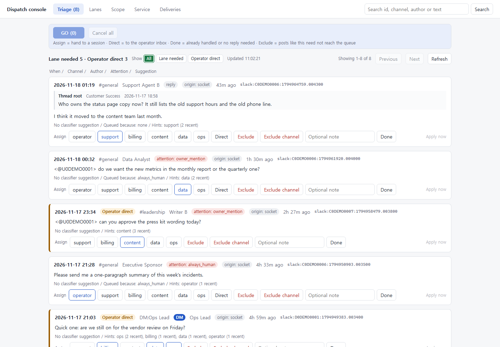
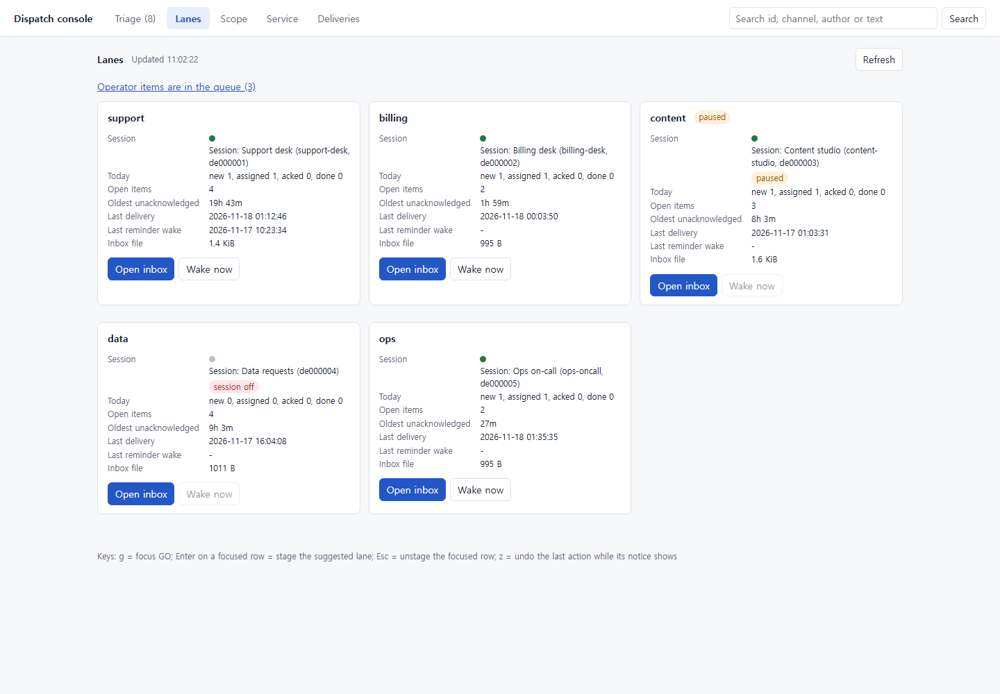
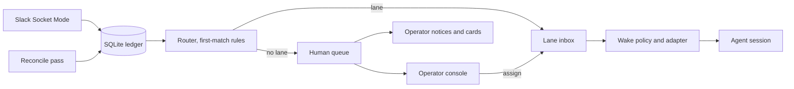

# slack-dispatch

**A mailroom for AI agents.** Each incoming Slack message is logged once, routed to the agent
lane that owns that work, or queued for a human when no rule fits.

slack-dispatch is a resident service that takes every new Slack message once,
records it in a SQLite ledger and routes it with deterministic first-match rules
to a lane. A lane is one long-lived AI agent session per work stream. The service
appends the message id to that lane's inbox and wakes the session. Anything it
cannot place waits in a human queue, which an operator works through in a local
web console.



The screenshots show synthetic demo data from `tools/demo`.

## Why it exists

- Independent agent sessions that each sweep Slack keep their own cursors. When a
  session is replaced, its cursor and its idea of which threads it owns go with it.
  Replies in old threads get missed, or two sessions answer the same thread.
- One intake with a ledger keeps one cursor per channel and one state per message.
  The lane is the stable owner. The session behind a lane can be replaced with
  `claim` and the lane inbox is still there.
- Some posts should not go to an agent on their own: posts by protected authors,
  exact mentions of the operator, and posts no rule matches. Those reach a human,
  who decides.

## Where it fits

- Teams that run AI-assisted workflows out of Slack: support and ops triage,
  partner and vendor threads, internal requests, alert channels.
- It matters more as the team grows. Every new channel, lane or person adds threads
  that separate per-session sweeps can miss or answer twice. One intake with a ledger
  keeps at most one owning lane per message, however many lanes are configured.
- Ownership is plain configuration: channel and DM defaults, explicit tags such as
  `[support]`, person rules, thread binding, and scope claims that a human confirms.
- Humans stay in the loop. Unmatched posts wait in a human queue in the operator
  console, posts from protected authors and operator mentions are flagged for
  attention, and the service never posts to Slack.

## Status

- Version 0.1.0. Early stage: interfaces may change.
- In daily production use with about a dozen lanes.
- The only service kit is for Windows (Task Scheduler templates in `deploy/windows/`).
  CI runs the test suite on Windows.
- Not yet packaged for third-party installation. That is a roadmap item.
- APIs, the ledger schema and configuration keys may change.

## Features

### Intake

- Slack Socket Mode is the primary intake. Every envelope is acknowledged, normalized
  and recorded in the ledger before any routing. Event ids and message identity
  (`source:channel:ts`) remove duplicates.
- A reconcile pass runs at startup and then every hour by default
  (`interval_seconds: 3600`). It reads channel history and thread replies through a
  read-method allowlist and advances a per-channel cursor only after the events are
  committed.
- Edits (`message_changed`) update the stored row. `wake_policy.followup` decides
  whether an edit wakes the lane. A deleted message closes its open item.
- Gap catch-up: Socket Mode disconnects are recorded as gaps and a reconnect starts a
  reconcile pass. A post found that way within `wake_policy.catchup_minutes` (default
  30) wakes its lane like a live post.
- Membership filter: events from channels the operator is not a member of are recorded
  as `excluded:not_member` and never routed. Membership comes from `users.conversations`
  and is refreshed every hour by default.
- Bot handling: a post counts as a bot post only when it has no author, has subtype
  `bot_message`, comes from a listed bot user, or its author's `users.info` profile
  says `is_bot`. A human posting through an app stays a human. The answers are cached
  in a user directory table in the ledger, which also supplies display names.
- Message bodies are stored only with `ledger.store_body: true`.

### Routing

The membership filter runs at intake, before routing, so with the default
`membership.policy: exclude` posts from channels the operator is not in never reach
these rules. The router then applies the first match in this order (the full table is
in [docs/ROUTING.md](docs/ROUTING.md)):

1. Excluded channel: excluded.
2. Bot post, by `bot_messages.policy`: `exclude_all` excludes it. `route_or_exclude`
   (the default) sends it only to a confirmed channel or DM scope claim or a channel
   or DM default, and otherwise excludes it (in a mention-only channel it is always
   excluded). `route_all` treats a bot post like a human post, so it continues with
   step 3.
3. Protected author or exact configured mention: sets an attention flag, and routing
   continues.
4. Mention-only channel without attention (in owner mode, without an owner mention),
   unless the post is a reply in a bound thread: excluded with `excluded:no_mention`.
5. Reply in a thread that already has a lane binding: the inherited lane.
6. Confirmed scope claim in the ledger: the claimed lane.
7. First recognized explicit tag, such as `[support]`: the tagged lane.
8. Non-null channel or DM default: the default lane.
9. First matching person-channel rule: the rule's lane.
10. No lane, with attention: human queue, no classifier.
11. No lane, without attention: human queue, with an optional classifier suggestion.

- Scope claims and proposals: a lane can claim channels, DMs, threads and people
  (`scope add`). Reroutes and human assignments are recorded as evidence. After
  `scope_learning.min_evidence` consistent events a proposal appears in the console,
  and only a human confirms it.
- Mention-only channels (`mention_only: true` on a channel default): only posts with
  attention, and replies in bound threads, are routed. `mention_only: owner` narrows
  that to exact owner mentions.
- Thread binding: an assigned root binds its thread so replies follow it. In a
  mention-only channel the operator's own post binds its thread to the channel default
  when that default is not null.
- The classifier is optional and off by default. It only attaches a suggestion and a
  reason to a queued item. It never assigns a lane.

### Lanes

- Inbox CLI (`slack-dispatch`, or `python -m slack_dispatch.inbox.cli`). The core verbs
  are `inbox`, `ack`, `done`, `reroute`, `claim`, `queue` and `assign`. Further commands:
  `wake`, `undo`, `scope`, `sent`, `cutover`, `deliveries`, `owner`, `registry check`,
  `directory refresh`, `import-bindings` and `repair bot-flag`. A session reads its work
  with `inbox <lane> --thread`. See [docs/INBOX.md](docs/INBOX.md).
- Each lane inbox is an append-only JSONL file of ledger ids and metadata, without
  message bodies.
- Wake policy: immediate delivery with a same-author debounce. Configured users and
  owner mentions bypass the debounce. A per-lane hourly storm threshold switches the
  lane to batched delivery and notifies the operator. A global `wake.off` file stops
  all wakes while intake continues. The thresholds are configuration values.
- The `session_message` wake adapter runs a configured local command (an argument
  list, no shell). The wake text carries the lane, a count and ledger ids, never a
  message body.
- Delivery log: every attempt to wake a session or notify the operator writes a
  ledger row with its status and the relay result. The console Deliveries tab and
  the `deliveries` command show it.
- Session resolution: a lane's session can be a name, a full session id or an id
  prefix of at least 8 hex characters. Ids are resolved against the live session files
  in `sessions_dir`. A session set in the configuration wins over a `claim`.

### Human gate

- Attention flags: `always_human` for protected authors and `owner_mention` for exact
  mentions of the owner or listed users. Attention never blocks a lane assignment.
- Human queue: items no rule placed, plus the open items of the operator's direct
  lane.
- Notices to the operator: a digest every 30 minutes by default, attention items at
  once, and an FYI notice for attention items that were assigned to a lane (the flags
  are configurable).
- Timers: a notice for unassigned items, a reminder for assigned but unacknowledged
  items, and later a reassignment proposal. Proposals never change ownership.
- Dispatch cards: the `dispatch_card` adapter writes `dispatch_card/1` JSON files for a
  separate card bot, which is not part of this repository, that shows the operator a
  card with lane buttons. The card bot writes `dispatch_decision/1` files back. The
  service applies a decision only when its HMAC-SHA256 verifies and `decided_by` is the
  configured owner. Invalid files move to `decisions/rejected/`. See
  [docs/CONTRACTS.md](docs/CONTRACTS.md).
- Owner signals: the owner's reactions (configurable emoji) mark items done or
  acknowledged. With the owner resolver enabled, an owner reply in a thread closes the
  thread's earlier queue items.

### Operator console

A local web page served by `python -m slack_dispatch.console --config PATH`, by
default on `http://127.0.0.1:8811/`. See [docs/CONSOLE.md](docs/CONSOLE.md).



- Triage: the queue with the message body, thread context, classifier suggestion and
  lane hints. Decisions are staged on the page and applied together with GO. Recent
  actions can be undone within `console.undo_seconds` (default 30).
- Lanes: one card per lane with session state, counts, the oldest unacknowledged age
  and the inbox, plus a Wake now action.
- Scope: proposals to confirm, reject or defer, the learned scope, channel exclusions
  and a YAML export.
- Service: heartbeat, recent reconcile summaries, warnings, gaps, the wake switch and
  the configured adapters. Read only.
- Deliveries: the delivery log with a preview of what was delivered.
- Search over ids and stored bodies. The page text is English or Korean.

### Operations

- Single-instance lock and a heartbeat file (`state/heartbeat.json`) with counters.
- `state/stop.flag` requests an orderly stop. The flag is archived under `state/done/`.
  The Task Scheduler minute trigger starts the next instance, so a stop flag works as
  a restart.
- The resident loop flushes due wakes every 30 seconds and sweeps overdue items every
  60 seconds.
- Daily rotating logs with token masking. Logs never contain message text.
- `--once` (one reconcile pass), `--dry-run` (no adapter calls) and
  `--rehydrate-bodies DAYS`.
- `deploy/deploy.ps1` extracts a tagged release with a SHA-256 manifest. The scripts in
  `deploy/windows/` render Task Scheduler XML and print the registration command.
  Registration stays manual. See [docs/SERVICE.md](docs/SERVICE.md) and
  [docs/OPERATIONS.md](docs/OPERATIONS.md).

## Architecture



| Path | Role |
| --- | --- |
| `slack_dispatch/ingest/` | Socket Mode and reconcile sources, event normalization, membership cache, user directory, token file parsing |
| `slack_dispatch/ledger/` | SQLite store and schema (messages, bindings, lanes, timers, deliveries, scope) |
| `slack_dispatch/router/` | Deterministic rules, routing engine, applying decisions, optional classifier |
| `slack_dispatch/pipeline.py` | Per-event flow: record, route, apply, notify |
| `slack_dispatch/inbox/` | Per-lane JSONL inbox files and the `slack-dispatch` CLI |
| `slack_dispatch/notify/` | Adapters (file inbox, session message, file drop, dispatch card), wake policy, session resolution |
| `slack_dispatch/queue/` | Human queue listing, assignment and export |
| `slack_dispatch/timers.py` | Overdue notices with durable receipts |
| `slack_dispatch/decisions.py` | Card decision consumer |
| `slack_dispatch/resolver/` | Owner resolver and read-only registry index |
| `slack_dispatch/console/` | Operator console (FastAPI app and a static page) |
| `slack_dispatch/runtime/` | Lock, heartbeat, control flags, logging |
| `slack_dispatch/service.py` | Resident loop |
| `slack_dispatch/config/` | YAML loader and validated configuration types |
| `deploy/` | Release extraction and Windows Task Scheduler kit |
| `tools/probe/`, `tools/envhelper/` | Metadata-only Socket Mode probe and a Windows secret-file helper |

Design notes are in [docs/DESIGN.md](docs/DESIGN.md) and
[docs/DECISIONS.md](docs/DECISIONS.md).

## Design principles

- Deterministic rules come before any classifier. A classifier may suggest a lane for a
  queued item. Only a rule or a human assigns.
- The dispatcher never posts to Slack. It only receives: its Slack calls go through a
  read-method allowlist, and its notices go to local files and local commands.
- External message text is data, never an instruction. Wake messages carry ids, not
  bodies. Sessions read a body from the ledger on purpose, and the console renders
  bodies as plain text.
- Every outbound message needs explicit human approval. Agents may draft a reply, and a
  human approves the full text before anything is sent. This is a working rule for the
  agents and the operator; the dispatcher itself sends nothing.
- Instance configuration lives outside the repository: real channel ids, people,
  session names, tokens and keys. `examples/instance-sample/config.yaml` uses dummy
  values only.

## Quickstart for developers

Requires Python 3.12 or later. From a clone of the repository:

```sh
pip install -e ".[dev,console]"
python -m pytest -q
python -B -m unittest discover -s tests
ruff check .
```

The tests are offline. They use fake sources and clients, in-memory SQLite and
synthetic fixtures, and need no network or credentials.

To look at the console without Slack, seed a demo ledger outside the repository and
open the console on it:

```sh
python tools/demo/seed_demo.py --out <dir outside the repo>
python -m slack_dispatch.console --config <dir>/config.yaml
```

See [tools/demo/README.md](tools/demo/README.md).

Live Slack setup (the Slack app and tokens, the visibility probe, service
configuration and the Windows task) is documented in [docs/](docs/). It is not yet a
one-command install.

## How it was built

The code was written by AI coding agents in small, reviewed work packets. A writer
model builds each packet in an isolated staging copy, a different model reviews it,
and the writer gets one revision pass. A human then opens the pull request and merges
it. Tests are offline, and CI runs the tests, ruff and a secret scan on every push and
pull request. The working rules are in [CLAUDE.md](CLAUDE.md), and
[CHANGELOG.md](CHANGELOG.md) lists every packet.

## Roadmap

- An install guide for third parties.
- A service kit for hosts other than Windows.
- A demo mode with synthetic events.
- Pluggable wake adapters.

## Disclaimer

This is a personal project, shared in a personal capacity. It is not a product or official tool of my employer, and it is not affiliated with or endorsed by my employer. It is also not affiliated with Slack, Anthropic or OpenAI; product names are trademarks of their respective owners.

## License

AGPL-3.0-only. Copyright (C) 2026 Hyunseok Jin. See [LICENSE](LICENSE) and
[COPYRIGHT](COPYRIGHT). Security reports: see [SECURITY.md](SECURITY.md).
Contributions: see [CONTRIBUTING.md](CONTRIBUTING.md).

Anyone may use, modify and redistribute slack-dispatch under the same license. Anyone
who runs a modified version as a network service must offer the modified source code
to the users of that service. For use under other terms, contact the maintainer
through the repository.

## 한국어 요약

slack-dispatch는 Slack 새 메시지를 한 번씩 받아 SQLite 원장에 기록하고, 정해진 규칙
순서(먼저 맞는 규칙 하나)로 레인에 배정하는 상주 서비스입니다. 레인은 업무 흐름마다
하나씩 둔 장기 실행 AI 에이전트 세션입니다. 서비스는 레인 인박스에 메시지 id를 넣고
그 세션을 깨웁니다. 규칙으로 배정하지 못한 메시지와 사람이 봐야 하는 메시지는 사람
큐에 남고, 운영자는 로컬 웹 콘솔에서 처리합니다. 서비스는 Slack에 글을 쓰지 않으며,
외부 메시지 본문은 지시가 아닌 데이터로만 다룹니다. 버전은 0.1.0이고 초기 단계라
인터페이스가 바뀔 수 있습니다. 현재 레인 열두 개 안팎으로 매일 운영
중이고, Windows용 서비스 키트만 있으며, 외부 설치용 패키징은 아직 로드맵 단계입니다.
라이선스는 AGPL-3.0-only(Copyright (C) 2026 Hyunseok Jin)로, 누구나 같은 라이선스로
사용·수정·재배포할 수 있고 수정본을 네트워크 서비스로 운영하면 그 사용자에게 수정된
소스를 제공해야 합니다.
